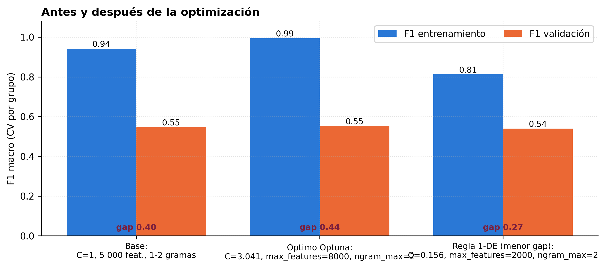
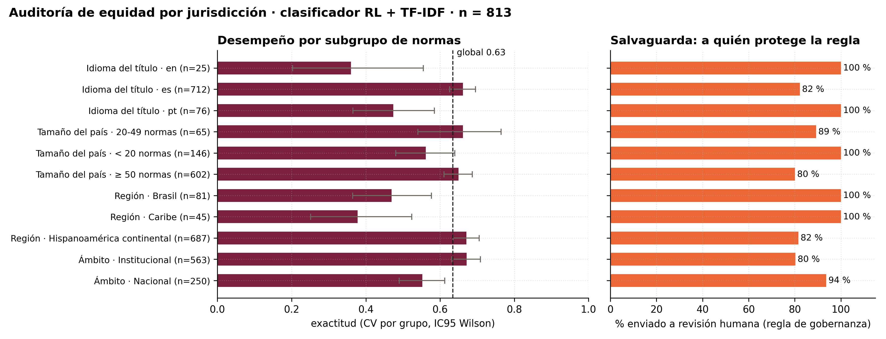
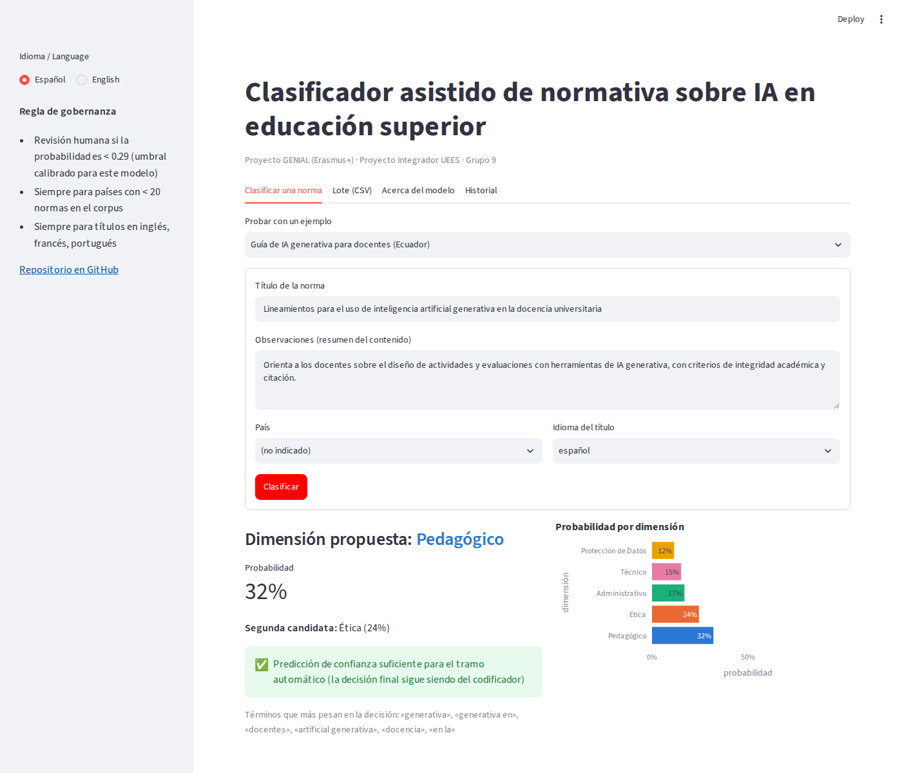
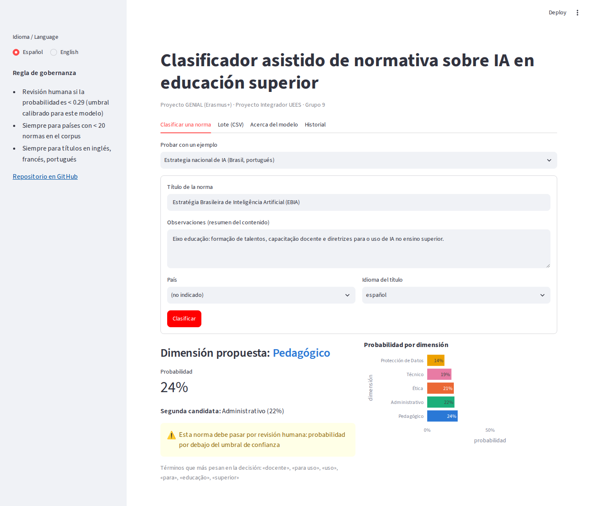
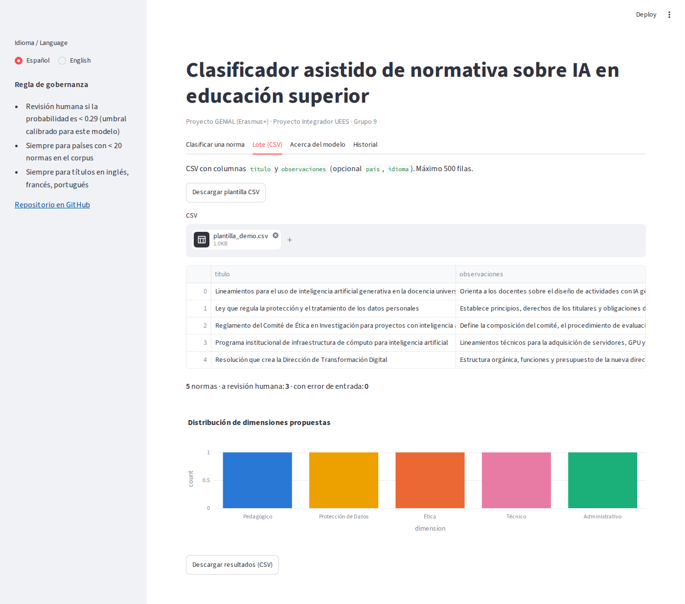
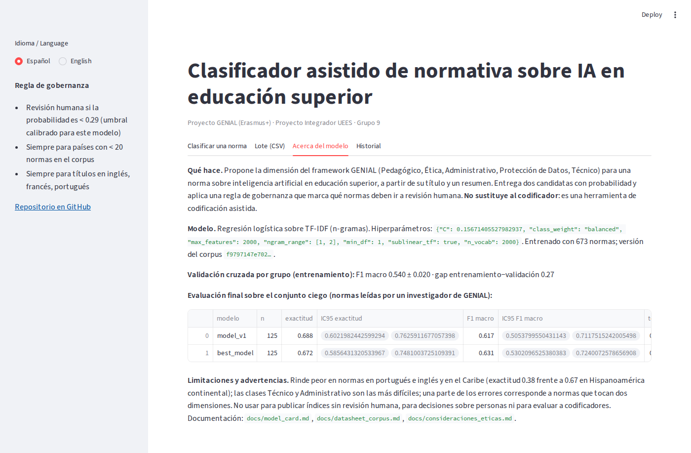

# genial-clasificador-normativa

**Clasificación automática de normativa sobre inteligencia artificial en la educación superior de América Latina y el Caribe: hacia un Índice de Madurez Normativa (IMN) escalable**

[](https://www.python.org/)
[](https://scikit-learn.org/)
[](https://genial-clasificador.streamlit.app)
[](https://github.com/jorgemaldonadom-cmd/genial-clasificador-normativa/actions/workflows/tests.yml)
[](LICENSE)
[](CHANGELOG.md)

Proyecto Integrador (MIAR0545) · Maestría en Inteligencia Artificial · Universidad de Especialidades Espíritu Santo (UEES) · **Grupo 9** · Jorge Javier Maldonado Mahauad y Melissa Figallo · Tutora: Gladys María Villegas Rugel · septiembre-octubre de 2026 · En colaboración con el proyecto [GENIAL](https://genial-project.eu) (Erasmus+).

> **Resultado en una línea.** Un clasificador lineal (TF-IDF + regresión logística ponderada) asigna la dimensión de una norma a partir de su título y observaciones con F1 macro **0.63** [0.53, 0.72] y κ **0.54** frente a un codificador humano en una prueba ciega de 125 normas (p < 0.001 frente a la clase mayoritaria), y se despliega como **codificación asistida** con revisión humana obligatoria para idiomas y países subrepresentados.

## Tabla de contenidos

1. [Descripción del problema](#1-descripción-del-problema)
2. [Dataset](#2-dataset)
3. [Metodología](#3-metodología)
4. [Resultados](#4-resultados)
5. [Instalación y ejecución](#5-instalación-y-ejecución)
6. [Interfaz de usuario](#6-interfaz-de-usuario)
7. [Estructura del repositorio](#7-estructura-del-repositorio)
8. [Consideraciones éticas](#8-consideraciones-éticas)
9. [Autores y roles](#9-autores-y-roles)
10. [Licencia](#10-licencia)
11. [Agradecimientos](#11-agradecimientos)
12. [Vídeos](#12-vídeos)
13. [Documentación](#13-documentación)
14. [Cómo citar](#14-cómo-citar)

## 1. Descripción del problema

El observatorio regional del proyecto GENIAL codifica manualmente cada norma sobre IA en educación superior en una de cinco dimensiones —**Pedagógico, Ética, Administrativo, Protección de Datos, Técnico**— y ese conteo alimenta el Índice de Madurez Normativa por país. La codificación manual (≈ 10 min por norma) no escala al ritmo al que aparecen normas, depende de un único codificador por norma y carece de fiabilidad intercodificador medida.

**Objetivo:** construir y evaluar un clasificador automático de la dimensión a partir del texto de la norma, compararlo con líneas base sobre un conjunto de prueba **a ciegas** codificado por un investigador del consorcio, e integrarlo en un flujo de codificación asistida con una regla de gobernanza explícita (umbral de confianza calibrado, revisión humana obligatoria para países con pocas normas e idiomas distintos del español).

**Por qué importa:** sin salvaguardas, un índice calculado con etiquetas automáticas subestimaría sistemáticamente la madurez normativa de las jurisdicciones pequeñas y no hispanohablantes, justo las que el observatorio quiere visibilizar.

## 2. Dataset

| | |
|---|---|
| Fuente | Corpus consolidado del observatorio GENIAL (Erasmus+), no publicado; uso autorizado por escrito |
| Tamaño | **813 normas × 13 columnas**, 27 países (28 jurisdicciones), 2024-2026 |
| Texto de entrada | `título + observaciones` (mediana 44 palabras) |
| Variable objetivo | `Dominio`: Pedagógico 294 · Ética 265 · Administrativo 120 · Protección de Datos 71 · Técnico 63 (desbalance 4.7 : 1) |
| Idiomas | español 712 · portugués 76 · inglés 25 |
| Integridad | SHA-256 `f9797147…3f33` verificado por el pipeline |
| Particiones | entrenamiento 673 · pool *few-shot* 15 · **prueba ciega 125** (las normas del instrumento de codificación independiente del investigador A) |
| Fuga de información | `Investigador` (V de Cramér 0.99 con `País`, dato personal), `Tipo de norma` y `Fecha` excluidas por diseño; duplicados por URL agrupados en toda validación |

El corpus y el instrumento **no se versionan**; en el repositorio hay una muestra pública de 40 normas (`data/samples/`), el hash, los agregados y los modelos entrenados. Detalles: [`data/README.md`](data/README.md), [`docs/analisis_datos.md`](docs/analisis_datos.md), [`docs/datasheet_corpus.md`](docs/datasheet_corpus.md).

## 3. Metodología

```
corpus → hash · limpieza · idioma · duplicados → particiones (ciega = instrumento del investigador)
      → líneas base (mayoritaria, metadatos) → TF-IDF 1-2 g + RL balanceada (CV por grupo de URL)
      → diagnóstico de overfitting → Optuna + sensibilidad → regla 1-DE → best_model
      → evaluación ciega (IC, McNemar, κ) → auditoría de equidad → regla de gobernanza → app Streamlit
```

* **Modelo**: `TfidfVectorizer(1-2 gramas) → LogisticRegression(class_weight='balanced')`. Elegido en la comparación de ocho técnicas de la Semana 2 por desempeño, interpretabilidad y coste (160 KB, < 2 s de entrenamiento).
* **Validación**: `StratifiedGroupKFold` (5 pliegues) estratificada por dimensión y agrupada por URL; intervalos de Wilson y *bootstrap* (2 000); McNemar pareado entre ramas.
* **Optimización** (Workshop S5): Optuna TPE, 60 ensayos; importancia fANOVA, dependencia parcial, interacción `C × max_features`, tabla de sensibilidad; selección por **regla de una desviación estándar con menor sobreajuste** → `best_model` (`C = 0.157`, 2 000 *features*). [`docs/optimizacion.md`](docs/optimizacion.md).
* **Umbral de confianza calibrado por modelo**: menor umbral con ≥ 85 % de exactitud en el tramo automático sobre predicciones fuera de muestra (0.50 para `model_v1`, 0.29 para `best_model`).
* **Rama LLM *few-shot***: Claude Sonnet 5.5 con el *prompt* versionado y 15 ejemplos (sin ajuste de pesos), tres ejecuciones sobre el mismo conjunto ciego; la clave de API vive fuera del repositorio (Gemini también soportado).
* **Equidad**: desempeño por idioma, tamaño del país, región, ámbito y codificador anonimizado; regla de los cuatro quintos como referencia.

Arquitectura y decisiones: [`docs/arquitectura.md`](docs/arquitectura.md).

## 4. Resultados

**Prueba ciega (n = 125, etiquetas del investigador A de GENIAL):**

| Modelo | Exactitud [IC 95 %] | F1 macro [IC 95 %] | Top-2 | κ | F1 Ped / Ética / Adm / PD / Téc |
|---|---|---|---:|---:|---|
| Clase mayoritaria | 0.360 [0.281, 0.447] | 0.106 | 0.360 | 0.00 | — |
| Metadatos (tipo de norma) | 0.544 [0.457, 0.629] | 0.322 | 0.608 | 0.32 | — |
| `model_v1` (base) | 0.688 [0.602, 0.763] | 0.617 [0.505, 0.712] | 0.872 | 0.56 | 0.78 / 0.73 / 0.35 / 0.74 / 0.50 |
| **`best_model` (regla 1-DE)** | 0.672 [0.586, 0.748] | **0.631 [0.530, 0.724]** | 0.864 | 0.54 | 0.74 / 0.71 / 0.33 / 0.80 / 0.57 |
| LLM *few-shot* (Claude Sonnet 5.5, 15 ejemplos) | 0.640 [0.553, 0.719] | 0.554 [0.447, 0.648] | 0.824 | 0.53 | 0.76 / 0.71 / 0.33 / 0.78 / 0.18 |

McNemar: `model_v1` vs mayoritaria p < 0.001; vs metadatos p = 0.012; `model_v1` vs `best_model` p = 0.75 (n.s.); LLM vs `best_model` p = 0.61 (n.s.). **El LLM *few-shot* empata con el modelo clásico** en exactitud y κ y queda por debajo en F1 macro (Técnico 0.18); 6 de 125 normas no obtuvieron respuesta en ninguna de las tres ejecuciones (cuentan como error); estabilidad entre ejecuciones 98 %. Un modelo lineal de 160 KB entrenado con 673 normas, interpretable y sin coste por llamada, es la opción adecuada para la operación; el LLM queda como segunda opinión opcional (`results/metrics/llm_resumen.json`). Validación cruzada por grupo (n = 813, base): exactitud 0.635 [0.601, 0.667], F1 macro 0.587 [0.549, 0.623], κ 0.50.

**Lo que explican los errores.** 35 de 37 errores ciegos revisados eran normas **multidimensionales**; el modelo acierta el 76 % cuando el codificador tuvo confianza *Alta* y el 41 % cuando fue *Media*. 23 de 39 errores se rescatan con la segunda dimensión.

**Optimización.** El F1 de validación es insensible a los hiperparámetros salvo `class_weight` (importancia 0.77); el mejor ensayo gana +0.6 pp (dentro del ruido). La regla 1-DE reduce el *gap* entrenamiento − validación de 0.40 a 0.27 sin perder F1.

**Equidad.** Exactitud por idioma es 0.66 · pt 0.47 · en 0.36; por región Hispanoamérica 0.67 · Brasil 0.47 · Caribe 0.38 (no cumplen la regla 4/5). La regla de gobernanza envía el 100 % de esas normas a revisión humana.

**Operación.** Con ≥ 85 % de exactitud automática, el 14-15 % de las normas queda en el tramo automático; sobre el corpus completo, 21 de 136 horas-persona por pasada. El valor operativo está en el top-2 y la explicación por términos: **codificación asistida**, no sustitución.

| | |
|---|---|
|  |  |

Cuadernos ejecutados: [`01_exploracion`](notebooks/01_exploracion.ipynb) · [`02_preprocesamiento`](notebooks/02_preprocesamiento.ipynb) · [`03_modelado`](notebooks/03_modelado.ipynb) · [`04_optimizacion`](notebooks/04_optimizacion.ipynb) · [`05_evaluacion`](notebooks/05_evaluacion.ipynb). Métricas en [`results/metrics/`](results/metrics/), figuras en [`results/figures/`](results/figures/), informes semanales en [`results/reports/`](results/reports/).

## 5. Instalación y ejecución

Requisitos: Python ≥ 3.11, Git. Probado en macOS y Linux.

```bash
git clone https://github.com/jorgemaldonadom-cmd/genial-clasificador-normativa.git
cd genial-clasificador-normativa
python -m venv .venv && source .venv/bin/activate      # Windows: .venv\Scripts\activate
pip install -r requirements.txt
```

**Solo la aplicación** (no necesita el corpus; los modelos están versionados):

```bash
pip install -r app/requirements.txt
streamlit run app/app.py                              # http://localhost:8501
```

**Pipeline completo** (requiere `data/raw/consolidado_limpio.xlsx` con autorización de GENIAL y, opcionalmente, `data/raw/codificacion_investigador_A.xlsx`):

```bash
python src/train.py --prepare          # prepara corpus y particiones, entrena model_v1 y best_model
python scripts/optimizar.py            # Optuna + sensibilidad (~6 min); después: python src/train.py --config best
python src/evaluate.py                 # evaluación ciega → results/metrics/evaluacion_final.*
python scripts/fairness_grupos.py      # auditoría de equidad
python -m pytest -q                    # pruebas
```

O, sin terminal, **`notebooks/00_ejecutar_todo.ipynb`**: cuaderno maestro que ejecuta todo paso a paso, omite lo ya calculado y lanza la aplicación en la última celda. Los cuadernos 01-05 documentan cada etapa.

**Clave de API (rama LLM, opcional):** Gemini (`GEMINI_API_KEY` o `data/raw/gemini_key.txt`) o Anthropic (`ANTHROPIC_API_KEY` o `data/raw/anthropic_key.txt`), o `.env`; nunca dentro de un cuaderno. El proveedor se elige en `config.yaml → llm.provider`. Configuración general en [`config.yaml`](config.yaml).

## 6. Interfaz de usuario

**Aplicación en línea:** **https://genial-clasificador.streamlit.app** (Streamlit Community Cloud, Python 3.11, se reconstruye con cada *push* a `main`; si lleva días sin visitas tarda ~1 min en despertar).

Aplicación Streamlit con cuatro pestañas: **Clasificar una norma** (formulario con validación, ejemplos precargados, botón, indicador de progreso, dimensión propuesta, segunda candidata, gráfico de probabilidades, aviso de revisión humana con motivos, términos influyentes), **Lote (CSV)** (plantilla, hasta 500 filas, validación por fila, gráfico de distribución, exportar CSV), **Acerca del modelo** (ficha, métricas, limitaciones) e **Historial** de sesión. Interfaz en español e inglés; diseño adaptable.

| Clasificar una norma | Revisión humana (portugués) |
|---|---|
|  |  |

| Lote CSV | Acerca del modelo |
|---|---|
|  |  |

Manual: [`docs/manual_usuario.md`](docs/manual_usuario.md). Pruebas de la interfaz: [`tests/test_app.py`](tests/test_app.py) (`streamlit.testing`).

## 7. Estructura del repositorio

Sigue la estructura requerida por el proyecto final; los elementos marcados con ➕ son adiciones propias del proyecto.

```
genial-clasificador-normativa/
│
├── README.md                          # Descripción principal del proyecto
├── requirements.txt                   # Dependencias de Python
├── .gitignore                         # Archivos a ignorar (corpus, claves, predicciones con texto)
├── LICENSE                            # Licencia MIT del código
├── config.yaml                        # ➕ Configuración centralizada (rutas, semilla, hiperparámetros, gobernanza)
├── CHANGELOG.md · CITATION.cff        # ➕ Historial de versiones y cita
├── DATA_LICENSE.md                    # ➕ Condiciones de uso de los datos GENIAL
├── .github/workflows/tests.yml        # ➕ Integración continua (pytest)
│
├── docs/                              # Documentación
│   ├── planificacion.md               # Documento de planificación inicial
│   ├── analisis_datos.md              # Análisis exploratorio de datos
│   ├── arquitectura.md                # Diseño del modelo y arquitectura
│   ├── optimizacion.md                # Proceso de optimización (Workshop S5)
│   ├── consideraciones_eticas.md      # Análisis ético del proyecto
│   ├── manual_usuario.md              # Guía para usuarios finales
│   ├── model_card.md · datasheet_corpus.md            # ➕ Fichas del modelo y del corpus
│   └── protocolo_codificacion_ciega.md · decisiones_metodologicas_v1.md · fig_*.png   # ➕
│
├── data/                              # Datos del proyecto
│   ├── raw/                           # Corpus e instrumento autorizados (NO versionados; solo .gitkeep)
│   ├── processed/                     # Corpus depurado generado por el pipeline (NO versionado)
│   ├── splits/                        # ➕ Particiones train / few-shot / prueba ciega (NO versionadas)
│   ├── samples/                       # ➕ Muestra pública de 40 normas, plantilla few-shot, CSV de demo
│   └── README.md                      # Descripción de los datos
│
├── notebooks/                         # Jupyter notebooks (ejecutados, con salidas)
│   ├── 01_exploracion.ipynb           # EDA
│   ├── 02_preprocesamiento.ipynb      # Limpieza y preparación
│   ├── 03_modelado.ipynb              # Entrenamiento de modelos
│   ├── 04_optimizacion.ipynb          # Optimización de hiperparámetros
│   ├── 05_evaluacion.ipynb            # Evaluación final (prueba ciega, enrutamiento, equidad, LLM)
│   ├── 00_ejecutar_todo.ipynb         # ➕ Cuaderno maestro paso a paso (reproduce todo y lanza la app)
│   ├── make_final_notebooks.py        # ➕ Generador de los cuadernos 00 y 02-05
│   ├── figuras/ · eda_resumen.json    # ➕ Figuras y resumen del EDA
│   └── anexos/                        # ➕ Experimento del Sprint 3 y diagnóstico de overfitting (Semana 3)
│
├── src/                               # Código fuente
│   ├── __init__.py
│   ├── data_processing.py             # Funciones de procesamiento
│   ├── model.py                       # Definición del modelo y Predictor
│   ├── train.py                       # Script de entrenamiento (+ calibración del umbral)
│   ├── evaluate.py                    # Script de evaluación
│   ├── utils.py                       # Funciones auxiliares
│   └── genial_clf/                    # ➕ Paquete interno: data, split, coder, classic, baselines,
│                                      #    evaluate, reliability, imn, llm, optimize, tracking, config
│
├── models/                            # Modelos entrenados
│   ├── best_model.pkl (+ .json)       # Mejor modelo guardado (regla 1-DE, umbral 0.29)
│   ├── model_v1.pkl (+ .json)         # Versión anterior (configuración base, umbral 0.50)
│   ├── entrenamiento.json             # ➕ Registro de la última ejecución de train.py
│   └── README.md                      # Descripción de modelos
│
├── app/                               # Aplicación / Interfaz
│   ├── app.py                         # Aplicación principal (Streamlit)
│   ├── requirements.txt               # Dependencias de la app
│   └── assets/                        # Capturas de pantalla
│
├── tests/                             # Pruebas unitarias
│   ├── test_data_processing.py
│   ├── test_model.py
│   ├── test_app.py
│   └── test_pipeline.py               # ➕ Pruebas del paquete genial_clf
│
├── results/                           # Resultados y visualizaciones
│   ├── figures/                       # Gráficos generados (figuras 10-18 + overfitting/)
│   ├── metrics/                       # Métricas de evaluación (CSV/JSON; optimizacion/, fairness/, overfitting/)
│   └── reports/                       # Reportes generados: documento técnico, entregables semanales, presentaciones
│
├── scripts/                           # ➕ Puntos de entrada: run_pipeline.py, optimizar.py, fairness_grupos.py
└── prompts/                           # ➕ Prompt versionado de la rama LLM
```

Convenciones de código: PEP 8, *docstrings* en todos los módulos y funciones públicas, `logging` en lugar de `print` en el código de biblioteca, configuración centralizada en `config.yaml`, semilla fija (2026). Flujo Git: `main` (versiones etiquetadas `v1.0.0`, `v1.1.0`, `v1.1.1`) y `dev` para trabajo en curso; historial en [`CHANGELOG.md`](CHANGELOG.md).

## 8. Consideraciones éticas

El sistema clasifica documentos públicos, no personas, pero sus salidas afectan a jurisdicciones y a codificadores. Resumen (completo en [`docs/consideraciones_eticas.md`](docs/consideraciones_eticas.md)):

* **Sesgos**: geográfico (5 países = 67 % de las normas), de idioma, de clase, de etiqueta única y de codificador. Mitigados con ponderación de clases, validación por grupo, top-2 y revisión obligatoria.
* **Equidad**: brechas por idioma y región que no cumplen la regla 4/5; se **contienen** con la regla de gobernanza (100 % de esas normas con respaldo humano) y se reauditan con cada versión.
* **Privacidad**: el nombre del codificador es dato personal: excluido del modelo, anonimizado, nunca enviado a un LLM; corpus e instrumento fuera del repositorio; claves de API fuera del control de versiones.
* **Transparencia**: modelo lineal con términos explicativos, probabilidades y motivos de revisión visibles; *model card* y *datasheet*; todas las cifras con intervalos.
* **Responsabilidad**: decisión final humana; declaración de compromiso del equipo; riesgo mínimo bajo el AI Act de la UE.
* **Limitaciones**: n = 125 en prueba, etiqueta única, κ humano-humano pendiente; la rama LLM se evaluó con un solo proveedor y un solo *prompt*.

## 9. Autores y roles

| Autor | Rol | Contacto |
|---|---|---|
| **Jorge Javier Maldonado Mahauad** | Dirección científica, ingeniería de datos y modelado, optimización, repositorio, aplicación | jorge.maldonado@ucuenca.edu.ec |
| **Melissa Figallo** | Análisis de errores, documentación ética, validación de la aplicación, vídeo | — |
| Gladys María Villegas Rugel | Tutora académica (UEES) | — |
| Investigador A (GENIAL) | Codificación ciega del conjunto de prueba | — |

## 10. Licencia

Código bajo licencia [MIT](LICENSE). Los datos del corpus GENIAL tienen condiciones propias ([`DATA_LICENSE.md`](DATA_LICENSE.md)): la muestra de `data/samples/` puede usarse con fines académicos citando al proyecto; el corpus completo no se redistribuye.

## 11. Agradecimientos

Al consorcio del proyecto **GENIAL** (Erasmus+, Unión Europea) por el acceso al corpus del observatorio y al investigador que realizó la codificación ciega; a la tutora Gladys María Villegas Rugel y al equipo docente de la Maestría en Inteligencia Artificial de la UEES; a la Universidad de Cuenca. Herramientas: scikit-learn, Optuna, Streamlit, Plotly, pandas, lingua.

## 12. Vídeos

| Vídeo | Enlace |
|---|---|
| *Pitch* del proyecto (5 min, con demostración de la aplicación) | **https://youtu.be/b1v6jRUY0oM** (YouTube, no listado) · diapositivas en [`results/reports/proyecto_final/`](results/reports/proyecto_final/) |
| Respuestas a las preguntas del comité | _pendiente de publicación_ |
| Presentación técnica (15 min, Sprint 3) | diapositivas en [`results/reports/presentacion_final/`](results/reports/presentacion_final/) |

## 13. Documentación

| Documento | Contenido |
|---|---|
| [`docs/planificacion.md`](docs/planificacion.md) | problema, objetivos, alcance, cronograma, roles, KPIs, riesgos |
| [`docs/analisis_datos.md`](docs/analisis_datos.md) | EDA, calidad, fuga de información, particiones |
| [`docs/arquitectura.md`](docs/arquitectura.md) | componentes, flujo, decisiones de diseño, despliegue |
| [`docs/optimizacion.md`](docs/optimizacion.md) | Workshop S5: Optuna, importancia, sensibilidad, antes/después |
| [`docs/consideraciones_eticas.md`](docs/consideraciones_eticas.md) | sesgos, equidad, privacidad, transparencia, impacto, responsabilidad, uso dual, limitaciones |
| [`docs/manual_usuario.md`](docs/manual_usuario.md) | uso de la aplicación con capturas |
| [`docs/model_card.md`](docs/model_card.md) · [`docs/datasheet_corpus.md`](docs/datasheet_corpus.md) | fichas del modelo y del corpus |
| [`results/reports/`](results/reports/) | documento técnico (Sprint 2), entregables de las Semanas 2-4, presentación y guion |

## 14. Cómo citar

```bibtex
@software{maldonado_figallo_2026_genial,
  author  = {Maldonado Mahauad, Jorge Javier and Figallo, Melissa},
  title   = {genial-clasificador-normativa: clasificación automática de normativa sobre IA en educación superior de ALC},
  year    = {2026},
  version = {1.1.0},
  url     = {https://github.com/jorgemaldonadom-cmd/genial-clasificador-normativa}
}
```

Véase también [`CITATION.cff`](CITATION.cff).
