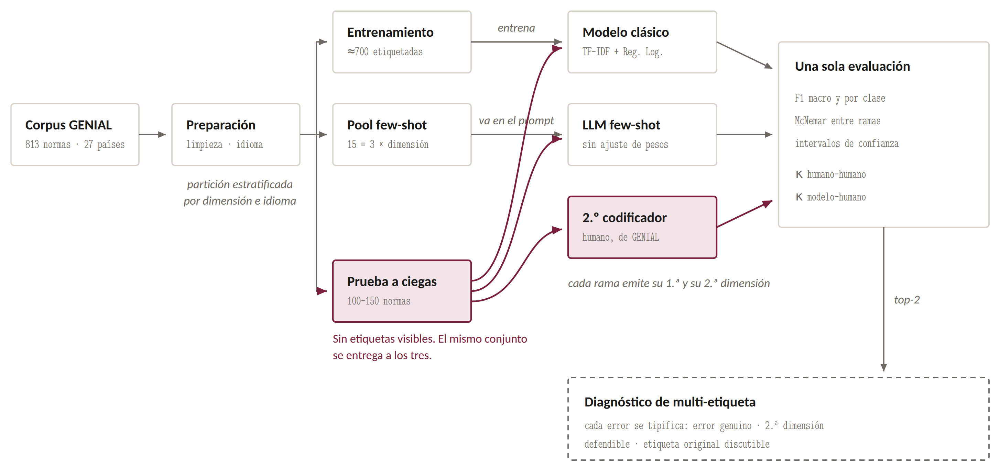
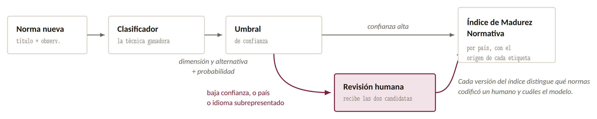

# genial-clasificador-normativa

**Clasificación automática de normativa sobre inteligencia artificial en la educación superior de América Latina y el Caribe: hacia un Índice de Madurez Normativa (IMN) escalable.**

Proyecto Integrador · Maestría en Inteligencia Artificial · Universidad de Especialidades Espíritu Santo (UEES) · Grupo 9
Jorge Javier Maldonado Mahauad · Melissa Figallo · septiembre-octubre de 2026
En colaboración con el proyecto [GENIAL](https://genial-project.eu) (Erasmus+).

> Estado: **planificación completada; desarrollo en curso (Sprint 2).** Este repositorio contiene el código inicial del *pipeline*, la muestra pública del corpus, el *prompt* versionado, la documentación de planificación y las pruebas unitarias. No contiene resultados: se publicarán al cierre del proyecto (25 de octubre de 2026).

---

## 1. Propósito

El observatorio regional del proyecto GENIAL codifica manualmente cada norma sobre IA en educación superior en una de cinco dimensiones (Pedagógico, Ética, Administrativo, Protección de Datos, Técnico). Ese conteo alimenta el Índice de Madurez Normativa (IMN) por país. La codificación manual no escala, depende de un único investigador por norma y no tiene fiabilidad intercodificador medida.

Este proyecto construye y evalúa un clasificador automático que asigna la dimensión a partir del texto de cada norma (título + observaciones), comparando **dos técnicas sobre idéntico conjunto de prueba a ciegas**:

| Rama | Técnica | Datos etiquetados que consume |
|---|---|---|
| Clásica | TF-IDF (1-2 gramas, 5 000 *features*) + Regresión Logística con `class_weight='balanced'` | ≈ 700 normas |
| LLM *few-shot* | Modelo de lenguaje de gran escala con las definiciones de las dimensiones y 15 ejemplos en el *prompt*, sin ajuste de pesos | 15 normas |

El desempeño de ambas se reporta **contra el acuerdo humano-humano** medido por doble codificación ciega del mismo conjunto, y el resultado se integra en un flujo asistido con umbral de confianza y revisión humana obligatoria para países e idiomas subrepresentados.

## 2. Los dos flujos

**El experimento** decide, con evidencia, qué técnica clasifica mejor:



**La operación** describe cómo se usa la técnica ganadora sin que el índice quede a merced del modelo:



Cada rama emite su primera **y** su segunda dimensión (top-2). Eso permite el diagnóstico de multi-etiqueta sin cambiar la tarea: cada error se tipifica como *error genuino*, *segunda dimensión defendible* o *etiqueta original discutible*.

## 3. Estructura del repositorio

```
├── README.md · LICENSE (MIT, código) · DATA_LICENSE.md (datos) · CITATION.cff
├── requirements.txt · config.yaml
├── data/
│   ├── README.md                        procedencia, hash SHA-256 del corpus congelado, diccionario de datos
│   ├── samples/sample_corpus_40.csv     40 normas reales anonimizadas (8 por dimensión, 13 columnas)
│   ├── samples/fewshot_examples_template.csv
│   └── raw/ · processed/ · splits/      vacíos en el repositorio; el corpus autorizado se coloca en data/raw/
├── src/genial_clf/
│   ├── data.py         carga + verificación de hash, corrección experta, idioma, duplicados, campo de texto
│   ├── split.py        muestreo estratificado por dimensión e idioma; archivos ciegos
│   ├── baselines.py    clase mayoritaria y línea base de metadata (Tipo de norma)
│   ├── classic.py      TF-IDF + Regresión Logística, validación cruzada, top-2, términos por dimensión
│   ├── llm.py          prompt few-shot, llamada a la API, parseo de top-2, repeticiones, estabilidad
│   ├── evaluate.py     F1, matriz de confusión, McNemar, IC de Wilson y bootstrap, kappa, desagregación
│   ├── reliability.py  kappa humano-humano, adjudicación, hoja de tipificación de errores
│   └── imn.py          umbral de confianza, enrutamiento, carga residual, tabla IMN con trazabilidad
├── scripts/run_pipeline.py              ejecución por etapas
├── prompts/clasificador_v0.1.md         prompt versionado con política de idioma
├── notebooks/01_eda.ipynb               exploración y reporte de calidad (Sprint 2)
├── docs/                                documento técnico (PDF), decisiones metodológicas, protocolo de codificación ciega
└── tests/test_pipeline.py               pruebas unitarias (partición sin fuga, métricas, parseo, enrutamiento)
```

## 4. Instalación

Requisitos: Python ≥ 3.11 y `pip`. Sin GPU: el modelo clásico entrena en segundos; el LLM se consume por API.

```bash
git clone https://github.com/jorgemaldonadom-cmd/genial-clasificador-normativa.git
cd genial-clasificador-normativa
python -m venv .venv && source .venv/bin/activate      # en Windows: .venv\Scripts\activate
pip install -r requirements.txt
python -m pytest -q                                    # 8 pruebas sobre la muestra pública
```

Para la rama LLM se necesita una clave de API en el entorno:

```bash
export ANTHROPIC_API_KEY="..."
```

(Alternativa documentada: un modelo abierto, p. ej. Qwen, servido en un *endpoint* compatible; se ajusta `llm.provider` y `llm.model` en `config.yaml`.)

## 5. Colocar el corpus autorizado

El corpus completo **no está en el repositorio** (véase `DATA_LICENSE.md`). Con la autorización del consorcio GENIAL, copie el archivo consolidado a `data/raw/consolidado_limpio.xlsx`. El *pipeline* verifica que sea exactamente la versión congelada:

```
SHA-256  f9797147e7026f796d453fa84d09c4bf32c48ae75c3744912806a72db3ff7f33
```

Si el hash no coincide, la etapa `prepare` se detiene: todos los resultados del proyecto se refieren a esa versión.

## 6. Uso

```bash
python scripts/run_pipeline.py prepare     # E1  corpus depurado + idioma + duplicados -> data/processed, results/reporte_calidad.md
python scripts/run_pipeline.py split       # E2  fewshot_examples.csv, test_blind.csv, test_labels_hidden.csv, train.csv
python scripts/run_pipeline.py baselines   # E3  clase mayoritaria y línea base de metadata
python scripts/run_pipeline.py classic     # E4  validación cruzada + predicción del conjunto ciego (pred_clasico.csv)
python scripts/run_pipeline.py llm         # E5  rama LLM (3 ejecuciones, temperatura 0); --dry-run no llama a la API
python scripts/run_pipeline.py evaluate    # E5  comparación pareada: abre test_labels_hidden.csv SOLO aquí
```

`python scripts/run_pipeline.py all --dry-run` ejecuta todo con la rama LLM simulada (útil para verificar la instalación).

**Regla de ceguera.** Ninguna etapa anterior a `evaluate` lee `test_labels_hidden.csv`. Las predicciones del LLM y del modelo clásico, y la codificación del segundo codificador humano, se producen sin acceso a las etiquetas.

## 7. Métricas y umbrales (fijados antes de ejecutar)

| Métrica | Mínimo aceptable | Excelencia |
|---|---|---|
| F1 macro (mejor rama) | ≥ 0.60 y superior a ambas líneas base con McNemar *p* < 0.05 | ≥ 0.70, IC inferior > 0.60 |
| F1 por clase | ninguna < 0.40 | ninguna < 0.50; Técnico ≥ 0.50 |
| Recall de Técnico y Protección de Datos | ≥ 50 % | ≥ 60 % |
| κ modelo-humano | ≥ 0.60 | ≥ κ humano-humano medido sobre el mismo conjunto |
| Normas enrutadas a revisión humana | ≤ 40 % | ≤ 30 % con exactitud ≥ 85 % en el tramo automático |

Piso aritmético (clase mayoritaria, sin entrenar nada): 36.2 % de exactitud y 0.106 de F1 macro. Toda métrica se reporta con intervalo de confianza; toda comparación entre ramas, con valor *p* de McNemar (diseño pareado); todo se desagrega por idioma y por país.

## 8. Archivos de salida

| Archivo | Contenido |
|---|---|
| `results/reporte_calidad.md` | distribución por dimensión, idioma y país; duplicados; variables excluidas |
| `data/splits/fewshot_examples.csv` | 15 ejemplos (3 por dimensión) con etiqueta |
| `data/splits/test_blind.csv` / `test_labels_hidden.csv` | conjunto de prueba sin etiqueta / etiquetas separadas |
| `results/pred_{mayoritaria,metadata,clasico,llm}.csv` | `id_norma, pred, pred_2, conf` por rama |
| `results/pred_llm_runs.csv` (+ `.meta.json`) | las tres ejecuciones del LLM con modelo y temperatura registrados |
| `results/comparacion_pareada.md` | F1, IC, κ, top-2, McNemar, métricas por idioma, curva enrutamiento-exactitud |
| `results/clasico_terminos_por_dimension.csv` | interpretabilidad de la rama clásica |

## 9. Licencias y permisos

| Componente | Licencia / condición | Verificado |
|---|---|---|
| Código de este repositorio | MIT (`LICENSE`) | sí |
| Muestra `data/samples/sample_corpus_40.csv` | uso académico con atribución al proyecto GENIAL (Erasmus+); investigador anonimizado (`DATA_LICENSE.md`) | sí, autorización de la coordinación |
| Corpus completo (813 normas) | **no redistribuible**; uso autorizado al equipo para este trabajo; solo se publica su hash y sus estadísticas agregadas | sí, autorización escrita (Sprint 1) |
| Normas originales | documentos públicos; el corpus registra la URL oficial de cada una | sí |
| Dependencias | scikit-learn (BSD-3), pandas (BSD-3), numpy (BSD-3), scipy (BSD-3), PyYAML (MIT), openpyxl (MIT), lingua-language-detector (Apache-2.0), anthropic (MIT), pytest (MIT), tabulate (MIT) | sí |
| Datasets alternativos (plan B) | MultiEURLEX CC-BY-4.0 (Hugging Face `coastalcph/multi_eurlex`); OECD.AI Policy Navigator, acceso público con atribución | sí |

## 10. Documentación

- `docs/Grupo_9_Documento_Tecnico_Presentacion_Proyecto.pdf` — documento técnico completo (estado del arte, datasets, métricas, stakeholders, alcance, cronograma Scrum, recursos, hitos, anexos).
- `docs/decisiones_metodologicas_v1.md` — las cuatro condiciones metodológicas del tutor y su resolución.
- `docs/protocolo_codificacion_ciega.md` — protocolo para el segundo y tercer codificador.

## 11. Cómo citar

Véase `CITATION.cff`. Texto sugerido:

> J. J. Maldonado Mahauad y M. Figallo, «Clasificación automática de normativa sobre inteligencia artificial en la educación superior de América Latina y el Caribe: hacia un Índice de Madurez Normativa escalable», Proyecto Integrador, Maestría en Inteligencia Artificial, UEES, 2026. Repositorio: https://github.com/jorgemaldonadom-cmd/genial-clasificador-normativa. Corpus: Proyecto GENIAL (Erasmus+).
