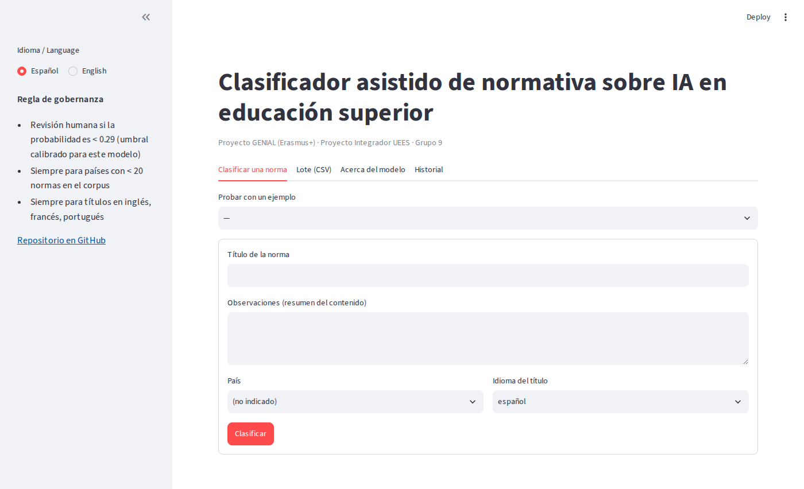
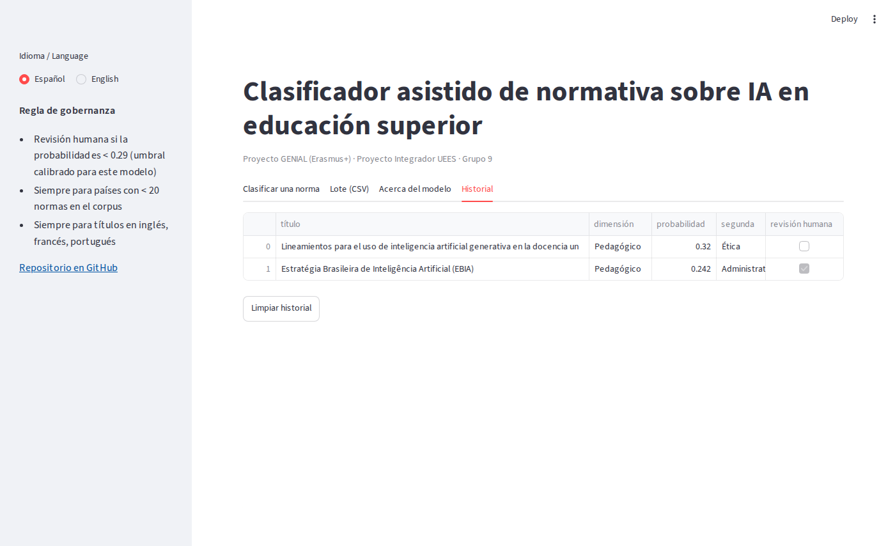
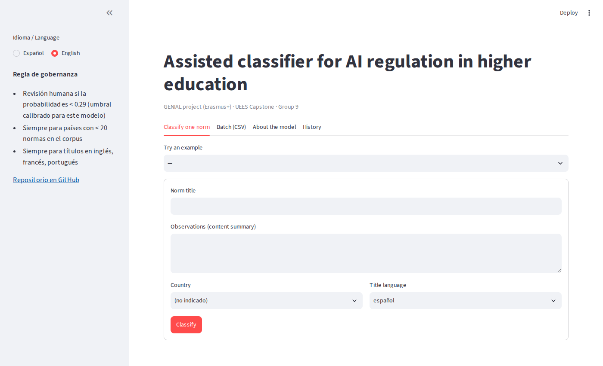

# Manual de usuario · Clasificador asistido de normativa sobre IA en educación superior

Aplicación web (Streamlit) que propone la dimensión de una norma sobre inteligencia artificial en educación superior a partir de su título y observaciones, y decide si debe pasar por revisión humana. Pensada para los codificadores del observatorio GENIAL.

## 1. Acceso

* **En línea**: **https://genial-clasificador.streamlit.app** (Streamlit Community Cloud). Si la aplicación lleva días sin visitas, la primera carga tarda alrededor de un minuto mientras despierta.
* **Local**: con Python ≥ 3.11 y las dependencias instaladas (`pip install -r app/requirements.txt`), ejecute desde la raíz del repositorio:

  ```bash
  streamlit run app/app.py
  ```

  o la última celda de `notebooks/00_ejecutar_todo.ipynb`. Se abre http://localhost:8501.

No requiere cuenta ni datos personales. La aplicación carga `models/best_model.pkl` (versionado en el repositorio): no necesita el corpus.

## 2. Pantalla principal



* **Barra lateral**: idioma de la interfaz (Español / English), resumen de la regla de gobernanza (umbral de confianza del modelo, países con pocas normas, idiomas de revisión obligatoria) y enlace al repositorio.
* **Pestañas**: *Clasificar una norma*, *Lote (CSV)*, *Acerca del modelo*, *Historial*.

## 3. Clasificar una norma

1. (Opcional) Elija un ejemplo precargado en *Probar con un ejemplo* para ver el comportamiento sin escribir nada. Hay cinco, uno por dimensión, incluido uno en portugués.
2. Escriba el **título de la norma** y las **observaciones** (resumen del contenido, como en la hoja de codificación de GENIAL). El modelo necesita al menos 3 palabras y acepta hasta 5 000 caracteres; si el texto es más corto o más largo, muestra un mensaje de error y no clasifica.
3. Indique el **país** (lista de las 28 jurisdicciones del corpus) y el **idioma del título**.
4. Pulse **Clasificar**. Mientras calcula se muestra un indicador de progreso.


El resultado incluye:

| Elemento | Qué significa |
|---|---|
| **Dimensión propuesta** y **probabilidad** | la clase con mayor probabilidad del modelo |
| **Segunda candidata** | la siguiente en probabilidad; en el 85-87 % de las normas la etiqueta correcta está entre las dos |
| **Gráfico de probabilidades** | las cinco dimensiones, con el color de cada una |
| **Aviso verde / amarillo** | verde: la predicción supera el umbral y la norma podría ir al tramo automático; amarillo: **debe pasar por revisión humana**, con los motivos |
| **Términos que más pesan** | palabras del texto que empujan hacia la dimensión propuesta (explicación de la decisión) |


Motivos posibles de revisión: probabilidad por debajo del umbral calibrado del modelo (0.29 para el modelo actual); país con menos de 20 normas en el corpus; título en inglés, francés o portugués. **La decisión final es siempre del codificador**: la aplicación propone, no decide.

## 4. Lote (CSV)

Para clasificar muchas normas a la vez:

1. Descargue la **plantilla CSV** (botón en la pestaña) o prepare un archivo con columnas `titulo` y `observaciones` (opcionales: `pais`, `idioma` con valores `es`, `pt`, `en`, `fr`). Codificación UTF-8, máximo 500 filas.
2. Arrastre el archivo al cargador. La aplicación valida cada fila: las que no cumplen el mínimo de texto se marcan con error y no detienen el resto.
3. Revise la tabla de resultados (dimensión, probabilidad, segunda candidata, revisión humana), el resumen (normas a revisión, errores) y el gráfico de distribución.
4. Pulse **Descargar resultados (CSV)** para obtener el archivo con las predicciones añadidas.


## 5. Acerca del modelo

Muestra la ficha del modelo cargado: hiperparámetros, fecha, hash del corpus de entrenamiento, resultados de validación cruzada y de la prueba ciega (tabla `evaluacion_final`), umbral calibrado y limitaciones. Es la versión resumida de `docs/model_card.md`.


## 6. Historial

Lista las normas clasificadas en la sesión actual (título, dimensión, probabilidad, revisión). Se puede vaciar con el botón *Limpiar*. El historial **no se guarda** en ningún servidor: desaparece al cerrar la pestaña del navegador.



## 7. Interfaz en inglés

El selector de la barra lateral traduce etiquetas, avisos y ayudas; las dimensiones conservan su nombre en español porque son las categorías del instrumento GENIAL.



## 8. Preguntas frecuentes

**¿Por qué casi todas mis normas van a revisión humana?** Porque el umbral está calibrado para que el tramo automático tenga ≥ 85 % de exactitud, y eso deja fuera a la mayoría; además, toda norma en portugués/inglés/francés o de país pequeño va a revisión por diseño. El valor de la herramienta está en la propuesta top-2 y en los términos, no en la automatización.

**¿Puedo usar la dimensión propuesta directamente en el IMN?** No. Solo las etiquetas con respaldo humano deben alimentar el índice (véase `docs/consideraciones_eticas.md`).

**¿Qué hago si la aplicación muestra «No existe el modelo»?** Ejecute `python src/train.py` (o el cuaderno 00) para generar `models/best_model.pkl`.

**¿Funciona con normas de otros temas o países fuera de ALC?** No está evaluada para ello; los resultados no serían fiables.

**¿Dónde reporto un error?** En las *issues* del repositorio de GitHub.
