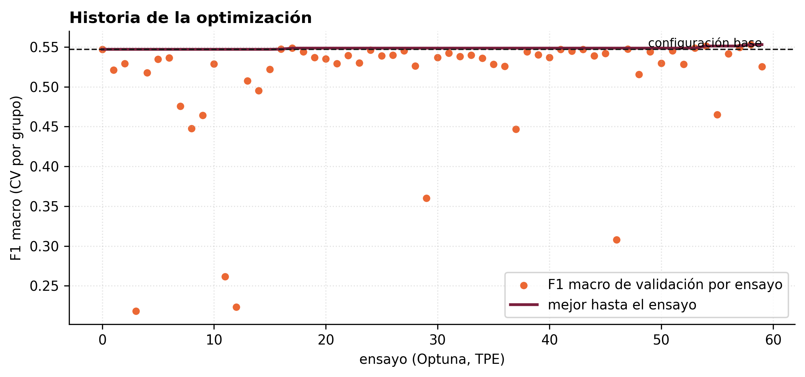
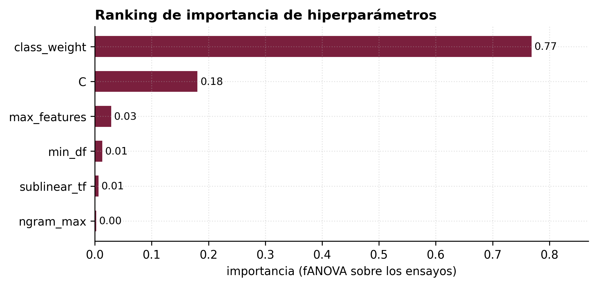
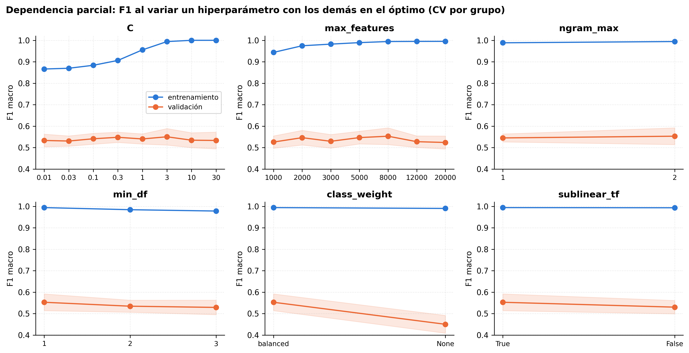
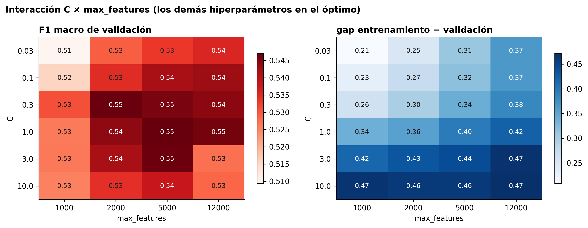

# Optimización de hiperparámetros y análisis de sensibilidad (Workshop S5)

Cuaderno: `notebooks/04_optimizacion.ipynb` · Código: `src/genial_clf/optimize.py`, `scripts/optimizar.py` · Resultados: `results/metrics/optimizacion/` · Figuras: `results/figures/13-17_*.png`.

## 1. Pregunta y diseño

¿Cuánto mejora el modelo base (TF-IDF 1-2 gramas, 5 000 *features*, regresión logística `C = 1` con `class_weight = balanced`) si se buscan sistemáticamente los hiperparámetros, y a cuáles es realmente sensible? La Semana 3 había mostrado un *gap* entrenamiento − validación de 0.40 y curvas de validación planas, lo que hacía prever una respuesta modesta; la optimización debía confirmarlo o refutarlo con un método explícito.

**Función objetivo**: F1 macro medio en validación cruzada estratificada por grupo de URL (5 pliegues) sobre el conjunto de entrenamiento (673 normas). El conjunto ciego no interviene.

**Espacio de búsqueda** (6 hiperparámetros):

| Hiperparámetro | Rango | Tipo |
|---|---|---|
| `C` | 0.01 – 30 | continuo, escala logarítmica |
| `max_features` | {1 000, 2 000, 3 000, 5 000, 8 000, 12 000, 20 000} | categórico |
| `ngram_max` | {1, 2} | categórico |
| `min_df` | {1, 2, 3} | categórico |
| `class_weight` | {balanced, None} | categórico |
| `sublinear_tf` | {True, False} | categórico |

**Método**: búsqueda bayesiana con Optuna 5.0 (muestreador TPE, 15 ensayos iniciales aleatorios, 60 ensayos, semilla 2026; el primer ensayo es la configuración base). Tiempo total: 5.5 min en CPU. Después: importancia fANOVA, dependencia parcial 1-D (barrido de cada hiperparámetro con los demás en el óptimo), dependencia parcial 2-D `C × max_features`, tabla de sensibilidad y comparación antes/después.

## 2. Resultados de la búsqueda

* 60 ensayos; F1 de validación entre 0.218 y **0.553** (mediana 0.537). El 68 % de los ensayos queda a ≤ 2 pp de la configuración base (0.547).
* Mejor ensayo: `C = 3.04`, 8 000 *features*, bigramas, `min_df = 1`, `balanced`, `sublinear_tf` → F1 **0.553 ± 0.039**, con *gap* 0.44 (entrenamiento 0.994).
* Los 11 ensayos sin ponderación de clases promedian 0.379 (máximo 0.495); los 49 con `balanced`, 0.537.

## 3. Ranking de importancia (fANOVA)

| Hiperparámetro | Importancia |
|---|---:|
| `class_weight` | **0.769** |
| `C` | 0.181 |
| `max_features` | 0.029 |
| `min_df` | 0.013 |
| `sublinear_tf` | 0.007 |
| `ngram_max` | 0.002 |

La ponderación de clases explica tres cuartas partes de la varianza del F1 entre ensayos: es la decisión que separa los ensayos buenos de los malos, y ya estaba tomada en el modelo base. `C` es el único otro hiperparámetro con efecto apreciable, y lo tiene sobre el *gap* más que sobre el F1 de validación.

## 4. Dependencia parcial y sensibilidad

Barrido de cada hiperparámetro con los demás fijos en el óptimo de Optuna:

| Hiperparámetro | Valores explorados | Óptimo | F1 val. mín – máx | Variación (pp) | gap mín – máx |
|---|---|---|---|---:|---|
| `class_weight` | balanced, None | balanced | 0.450 – 0.553 | **10.3** | 0.44 – 0.54 |
| `max_features` | 1 000 … 20 000 | 8 000 | 0.524 – 0.553 | 2.9 | 0.42 – 0.47 |
| `min_df` | 1, 2, 3 | 1 | 0.529 – 0.553 | 2.4 | 0.44 – 0.45 |
| `sublinear_tf` | True, False | True | 0.530 – 0.553 | 2.3 | 0.44 – 0.46 |
| `C` | 0.01 … 30 | 3.04 | 0.530 – 0.550 | 2.0 | **0.33 – 0.47** |
| `ngram_max` | 1, 2 | 2 | 0.545 – 0.553 | 0.8 | 0.44 |

Lectura: salvo `class_weight`, la variación del F1 de validación en todo el rango de cada hiperparámetro (≤ 3 pp) es del orden de la desviación estándar entre pliegues (2-4 pp). La curva de entrenamiento, en cambio, sube con `C` y con el tamaño del vocabulario: el modelo puede memorizar más, pero no generaliza más. El error restante no es de hiperparámetros, sino de etiqueta (normas multidimensionales) y de tamaño de muestra.

## 5. Interacción `C × max_features`

Rejilla 6 × 4 con los demás hiperparámetros en el óptimo. El F1 de validación es casi constante sobre toda la rejilla (0.51 – 0.55); el *gap* crece monótonamente con ambos ejes (de 0.26 en la esquina `C = 0.03`, 1 000 *features* a 0.47 en `C = 10`, 12 000). No hay interacción que cambie la decisión: a igual F1, conviene la esquina de menor `C` y menor vocabulario.

## 6. Antes y después: elección de `best_model`

| Configuración | F1 val. | ± DE | F1 train | gap |
|---|---:|---:|---:|---:|
| Base: `C = 1`, 5 000 *features*, 1-2 gramas | 0.547 | 0.020 | 0.942 | 0.40 |
| Óptimo Optuna: `C = 3.04`, 8 000 *features* | 0.553 | 0.039 | 0.994 | 0.44 |
| **Regla 1-DE (menor gap): `C = 0.157`, 2 000 *features*** | 0.540 | 0.020 | 0.813 | **0.27** |

**Regla de decisión**: entre los ensayos cuyo F1 de validación está a menos de una desviación estándar (la de la configuración base, 0.020) del máximo, se elige el de menor *gap* entrenamiento − validación. Es la regla de una desviación estándar de Breiman et al. adaptada al criterio del proyecto: mismo desempeño dentro del ruido, menos sobreajuste y menos varianza.

**Validación ciega** (`src/evaluate.py`, n = 125): `model_v1` exactitud 0.688, F1 macro 0.617 [0.505, 0.712]; `best_model` exactitud 0.672, F1 macro **0.631 [0.530, 0.724]**, F1 Técnico 0.57 (vs 0.50) y Protección de Datos 0.80 (vs 0.74). McNemar entre ambos: p = 0.75. La diferencia no es significativa; `best_model` se adopta por su menor sobreajuste y mejor cobertura de las clases pequeñas, no por su F1 puntual.

## 7. Consecuencia operativa: umbral de confianza por modelo

La regularización fuerte aplana las probabilidades: con el umbral fijo de 0.50 (calibrado para `model_v1`), `best_model` enviaría a revisión el 98 % de las normas. Por ello `src/train.py` calibra para cada modelo, sobre predicciones fuera de muestra, el menor umbral que da ≥ 85 % de exactitud en el tramo automático con ≥ 10 % de cobertura, y lo guarda en sus metadatos: **0.50 para `model_v1`** (14 % automático, exactitud 0.87) y **0.29 para `best_model`** (15 %, 0.85). La aplicación lee el umbral del modelo cargado.

## 8. Conclusiones del workshop

1. La optimización **no mejora** el F1 de validación de forma apreciable (+0.6 pp en el mejor ensayo, dentro del ruido); confirma el diagnóstico de la Semana 3.
2. Sí aporta un **ranking de importancia** claro (`class_weight` ≫ `C` ≫ resto) y una **configuración más estable** con 12 pp menos de sobreajuste.
3. El análisis de sensibilidad es la pieza útil: demuestra que no hay un hiperparámetro escondido que resuelva el problema, y reorienta el esfuerzo hacia los datos (etiqueta única en normas multidimensionales, países e idiomas subrepresentados).

Reproducir: `python scripts/optimizar.py --trials 60` o `notebooks/04_optimizacion.ipynb` con `EJECUTAR = True`.
